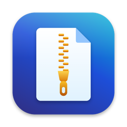

<p align="center"></p>

<h1 align="center">YUCE ZIP</h1>

<p align="center">
  <a href="README.md">🇹🇷 Türkçe</a> ·
  <a href="README.en.md">🇬🇧 English</a> ·
  <a href="README.pt-BR.md">🇧🇷 Português (Brasil)</a>
</p>

<p align="center">macOS için ücretsiz, açık kaynaklı ve grafik arayüzlü arşiv yöneticisi — <b>7-Zip</b> motoruyla.</p>

<p align="center">
  <a href="https://github.com/bariscagriyuce/yuce-zip/releases/latest"></a>
  
  
  
</p>

<p align="center"><a href="https://github.com/bariscagriyuce/yuce-zip/releases/latest"><b>⬇︎ YUCE ZIP'i indir (.dmg)</b></a></p>

---

## Özellikler

- **Açar:** 7z, ZIP, RAR, TAR, GZ, BZ2, XZ, ZSTD, ISO, DMG, CAB, WIM, ARJ, LZH, CPIO, RPM, DEB ve daha birçok biçim
- **Oluşturur:** 7z, ZIP, TAR, TAR.GZ, TAR.BZ2, TAR.XZ ve WIM arşivleri
- Arşiv içindeki klasörler arasında gezinme; çift tıklayarak dosya açma
- Tümünü ya da yalnızca seçili öğeleri çıkartma, **Buraya Çıkart**
- **AES-256 şifreleme** (7z ve ZIP), 7z'de dosya adlarını da şifreleme
- Parçalara bölme (CD, DVD, FAT32 vb.) ve sıkıştırma düzeyi seçimi
- Arşivi sınama; arşive dosya ekleme ve arşivden silme (7z, ZIP, TAR, WIM)
- **Sürükle-bırak:** arşiv bırakırsanız açar, dosya bırakırsanız sıkıştırır
- Finder'daki **Birlikte Aç** menüsünde görünür
- **Türkçe, English, Português (Brasil)** arayüz — Ayarlar'dan anında değiştirilir
- **Güncelleme denetimi:** yeni sürümleri GitHub Releases üzerinden kontrol eder
- **Finder sağ tık menüsü** (7-Zip gibi): *YUCE ZIP ▸* Buraya Çıkart, “ad/” klasörüne çıkart, Arşivi Sına, “ad.7z” / “ad.zip” olarak sıkıştır, Arşive Ekle…
- **Varsayılan uygulama:** tek tıkla tüm arşiv türleri için varsayılan uygulama olur

## Kurulum

1. [Releases](https://github.com/bariscagriyuce/yuce-zip/releases/latest) sayfasından `YUCE-ZIP-x.y.z.dmg` dosyasını indirin.
2. DMG'yi açın ve **YUCE ZIP**'i **Applications** (Uygulamalar) klasörüne sürükleyin.
3. Uygulamayı açın. Uygulama Developer ID ile imzalı ve Apple tarafından onaylıdır (notarized), uyarı vermeden açılır.

**Gereksinimler:** macOS 13 Ventura veya üzeri, Apple Silicon (M1, M2, M3, M4…).

## Kullanım

| İşlem | Nasıl yapılır |
|---|---|
| Arşiv açma | Arşivi pencereye ya da Dock simgesine sürükleyin, veya **Dosya → Arşiv Aç…** (⌘O) |
| Sıkıştırma | Dosyaları boş pencereye sürükleyin, veya **Dosya → Dosyaları Sıkıştır…** (⌘K) |
| Çıkartma | **Çıkart** düğmesi (⌘E) ya da **Buraya Çıkart** (⇧⌘E) |
| Arşivi sınama | **Sına** düğmesi (⌘T) |
| Dil değiştirme | **YUCE ZIP → Ayarlar…** (⌘,) |
| Güncelleme denetimi | **YUCE ZIP → Güncellemeleri Denetle…** |

## Varsayılan uygulama yapma

**YUCE ZIP → Ayarlar… → Sistem Entegrasyonu → “YUCE ZIP'i Arşivler İçin Varsayılan Uygulama Yap”**.
ZIP, 7z, RAR, TAR, GZ, BZ2, XZ, CAB, RPM, DEB, ARJ, LZH, ZST, WIM vb. türler YUCE ZIP ile açılır (ISO, DMG ve JAR sistemde kalır).
Elle yapmak için: dosyaya sağ tık → **Bilgi Al → Birlikte Aç: YUCE ZIP → Tümünü Değiştir**.

## Finder sağ tık menüsü

Finder'da bir dosyaya sağ tıklayınca **YUCE ZIP ▸** alt menüsü çıkar:

| Seçili öğe | Seçenekler |
|---|---|
| Arşiv | YUCE ZIP ile Aç · Dosyaları Çıkart… · Buraya Çıkart · “ad/” klasörüne çıkart · Arşivi Sına |
| Her dosya / klasör | Arşive Ekle… · “ad.7z” olarak sıkıştır · “ad.zip” olarak sıkıştır |

Menü ilk açılışta otomatik etkinleşir. Görünmüyorsa **Sistem Ayarları → Genel → Giriş Öğeleri ve Uzantılar → Finder** altında “YUCE ZIP”i açın
(veya Ayarlar'daki **Eklenti Ayarları…** düğmesi). Menüyü Ayarlar'dan kapatabilirsiniz.

## Kaynaktan derleme

```bash
brew install sevenzip      # 7zz sıkıştırma motoru
./scripts/build.sh         # build/YUCE ZIP.app + dist/YUCE-ZIP-<sürüm>.dmg
```

Betik, keychain'deki **Developer ID Application** sertifikasıyla imzalar ve `notarytool` profili varsa
DMG'yi Apple'a onaya gönderir (`NOTARY_PROFILE=<profil> ./scripts/build.sh`).

## Yeni sürüm yayımlama

```bash
echo 1.0.1 > VERSION && ./scripts/build.sh
gh release create v1.0.1 dist/YUCE-ZIP-1.0.1.dmg --title "YUCE ZIP 1.0.1" --notes "Yenilikler…"
```

Uygulama `https://api.github.com/repos/bariscagriyuce/yuce-zip/releases/latest` adresini kontrol eder;
etiket (ör. `v1.0.1`) yüklü sürümden yeniyse kullanıcıya indirmeyi önerir.

## Proje yapısı

| Dosya | Açıklama |
|---|---|
| `Sources/YuceZip/AppDelegate.swift` | Uygulama, menüler, pencereler |
| `Sources/YuceZip/BrowserView.swift` | Ana pencere: araç çubuğu, dosya tablosu, sürükle-bırak |
| `Sources/YuceZip/Sheets.swift` | Çıkartma, sıkıştırma ve özellikler pencereleri |
| `Sources/YuceZip/ArchiveModel.swift` | Arşiv modeli ve işlemler |
| `Sources/YuceZip/SevenZip.swift` | `7zz` süreç sarmalayıcısı ve çıktı ayrıştırıcı |
| `Sources/YuceZip/UpdateChecker.swift` | GitHub güncelleme denetimi |
| `Sources/YuceZip/Localization.swift` | Türkçe / İngilizce / Portekizce çeviriler |
| `Sources/YuceZip/Integration.swift` | Varsayılan uygulama, Finder menüsü komutları |
| `FinderExtension/FinderSync.swift` | Finder sağ tık menüsü eklentisi |
| `scripts/build.sh` | .app paketleme, ikon, imzalama, notarization, DMG |

## Lisans

YUCE ZIP [MIT](LICENSE) lisanslıdır. Gömülü 7-Zip motoru (`7zz`) © Igor Pavlov, GNU LGPL + unRAR kısıtlaması —
bkz. [`Resources/7-Zip-License.txt`](Resources/7-Zip-License.txt).
