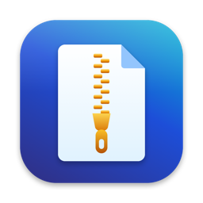

<p align="center"></p>

<h1 align="center">YUCE ZIP</h1>

<p align="center">
  <a href="README.md">🇹🇷 Türkçe</a> ·
  <a href="README.en.md">🇬🇧 English</a> ·
  <a href="README.pt-BR.md">🇧🇷 Português (Brasil)</a>
</p>

<p align="center">Gerenciador de arquivos compactados gratuito, de código aberto e com interface gráfica para macOS — com o mecanismo <b>7-Zip</b>.</p>

<p align="center">
  <a href="https://github.com/bariscagriyuce/yuce-zip/releases/latest"></a>
  
  
  
</p>

<p align="center"><a href="https://github.com/bariscagriyuce/yuce-zip/releases/latest"><b>⬇︎ Baixar o YUCE ZIP (.dmg)</b></a></p>

---

## Recursos

- **Abre:** 7z, ZIP, RAR, TAR, GZ, BZ2, XZ, ZSTD, ISO, DMG, CAB, WIM, ARJ, LZH, CPIO, RPM, DEB e muito mais
- **Cria:** arquivos 7z, ZIP, TAR, TAR.GZ, TAR.BZ2, TAR.XZ e WIM
- Navegue pelas pastas dentro do arquivo; clique duas vezes para abrir um item
- Extraia tudo ou apenas os itens selecionados, **Extrair Aqui**
- **Criptografia AES-256** (7z e ZIP), criptografia de nomes de arquivos no 7z
- Divisão em volumes (CD, DVD, FAT32…) e nível de compressão ajustável
- Teste arquivos; adicione e exclua itens (7z, ZIP, TAR, WIM)
- **Arrastar e soltar:** solte um arquivo compactado para abri-lo, ou arquivos para compactá-los
- Aparece no menu **Abrir com** do Finder
- Interface em **Türkçe, English, Português (Brasil)** — troca instantânea nos Ajustes
- **Verificação de atualizações** pelo GitHub Releases

## Instalação

1. Baixe `YUCE-ZIP-x.y.z.dmg` na página de [Releases](https://github.com/bariscagriyuce/yuce-zip/releases/latest).
2. Abra o DMG e arraste o **YUCE ZIP** para a pasta **Aplicativos**.
3. Abra o app. Ele é assinado com Developer ID e notarizado pela Apple, então abre sem avisos.

**Requisitos:** macOS 13 Ventura ou posterior, Apple Silicon (M1, M2, M3, M4…).

## Uso

| Tarefa | Como |
|---|---|
| Abrir um arquivo | Solte-o na janela ou no ícone do Dock, ou **Arquivo → Abrir Arquivo Compactado…** (⌘O) |
| Compactar | Solte arquivos numa janela vazia, ou **Arquivo → Compactar Arquivos…** (⌘K) |
| Extrair | Botão **Extrair** (⌘E) ou **Extrair Aqui** (⇧⌘E) |
| Testar um arquivo | Botão **Testar** (⌘T) |
| Mudar o idioma | **YUCE ZIP → Ajustes…** (⌘,) |
| Verificar atualizações | **YUCE ZIP → Verificar Atualizações…** |

## Compilar a partir do código-fonte

```bash
brew install sevenzip      # mecanismo de compressão 7zz
./scripts/build.sh         # build/YUCE ZIP.app + dist/YUCE-ZIP-<versão>.dmg
```

O script assina com o certificado **Developer ID Application** do seu keychain e, se existir um perfil do
`notarytool`, envia o DMG para notarização da Apple (`NOTARY_PROFILE=<perfil> ./scripts/build.sh`).

## Publicar uma nova versão

```bash
echo 1.0.1 > VERSION && ./scripts/build.sh
gh release create v1.0.1 dist/YUCE-ZIP-1.0.1.dmg --title "YUCE ZIP 1.0.1" --notes "Novidades…"
```

O app consulta `https://api.github.com/repos/bariscagriyuce/yuce-zip/releases/latest`; se a tag
(ex.: `v1.0.1`) for mais nova que a versão instalada, ele oferece o download.

## Estrutura do projeto

| Arquivo | Descrição |
|---|---|
| `Sources/YuceZip/AppDelegate.swift` | Ciclo de vida do app, menus, janelas |
| `Sources/YuceZip/BrowserView.swift` | Janela principal: barra de ferramentas, tabela, arrastar e soltar |
| `Sources/YuceZip/Sheets.swift` | Diálogos de extração, compactação e propriedades |
| `Sources/YuceZip/ArchiveModel.swift` | Modelo do arquivo e operações |
| `Sources/YuceZip/SevenZip.swift` | Wrapper do processo `7zz` e analisador de saída |
| `Sources/YuceZip/UpdateChecker.swift` | Verificador de atualizações via GitHub |
| `Sources/YuceZip/Localization.swift` | Traduções em turco / inglês / português |
| `scripts/build.sh` | Empacotamento, ícone, assinatura, notarização, DMG |

## Licença

O YUCE ZIP é licenciado sob [MIT](LICENSE). O mecanismo 7-Zip incluído (`7zz`) é © Igor Pavlov, GNU LGPL +
restrição unRAR — veja [`Resources/7-Zip-License.txt`](Resources/7-Zip-License.txt).
